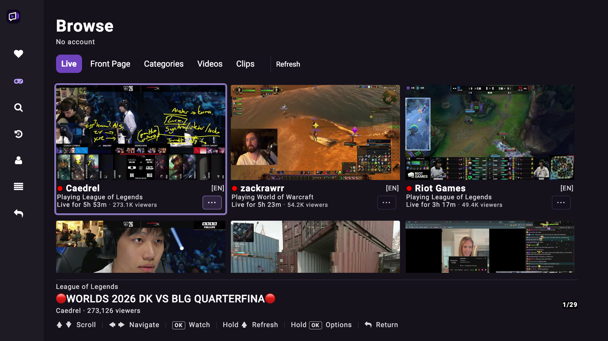
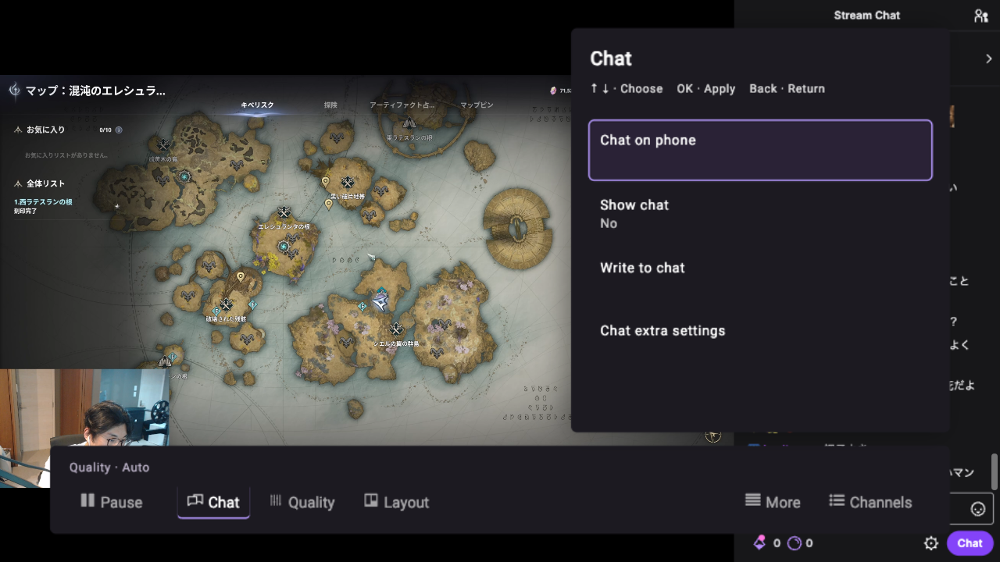
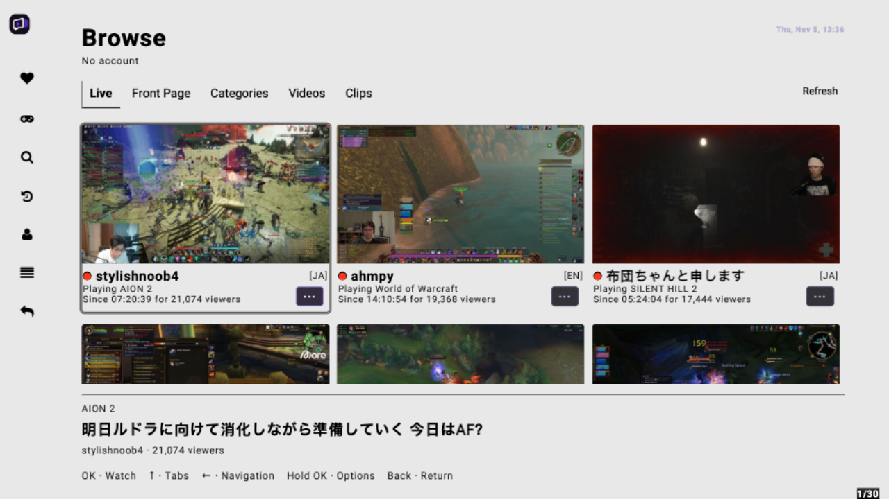

# Smarter Purple TV

<div align="center">



<a href="docs/ui-redesign-screenshots/production-browse-tabs-720.png">View the 720p Browse capture</a>


[](https://github.com/YofarDev/SmarterPurpleTV/releases/latest)
[](LICENSE)

**An unofficial Twitch client for Android TV and Google TV.**

Watch live streams, VODs and clips on your TV with the remote.

</div>

Smarter Purple TV (SPTV) is [SmartTwitchTV](https://github.com/fgl27/SmartTwitchTV) with a purple identity and fork-specific improvements.

## Features

- **Built for TV.** Navigate every screen with the directional remote, OK and Back.
- **Browse Twitch.** Live streams, categories, VODs, clips, search, Following and Library.
- **Watch your way.** Picture-in-picture, multistream, chat and optional Twitch login.
- **Better chat.** Native Twitch emotes plus BTTV, FrankerFaceZ and 7TV emotes.
- **Fork improvements.** Stitched-ad filtering without a proxy, automatic follow raids and a purple-first interface.
- **Chat on your phone.** Show a QR code on the TV and keep chatting from your phone. See the [phone-chat guide](docs/phone-chat-setup.md).
- **TwitchNoSub feature.** Watch any sub-only VOD on Twitch.

| Live player | Light theme |
| --- | --- |
|  |  |

## Install

1. Download the [latest APK](https://github.com/YofarDev/SmarterPurpleTV/releases/latest).
2. Sideload it on Android TV or Google TV. You may need to allow your file manager or downloader to install unknown apps.

The TV web interface can update independently of the APK, so many improvements do not require a reinstall.

## Build from source

The web app lives in `app/`; the Android host lives in `apk/`. Generated files in `release/` must be rebuilt, not edited by hand.

```sh
npm install
node release/scripts/maker.js
```

For the full Android build, translation workflow and architecture notes, see the [upstream build guide](https://github.com/fgl27/SmartTwitchTV#readme). The [phone-chat guide](docs/phone-chat-setup.md) contains the additional client-ID setup.

## Support

If SPTV is useful, you can [support development on Ko-fi](https://ko-fi.com/yofardev).

## Credits

SPTV is a fork of SmartTwitchTV by Felipe de Leon and its contributors. It is licensed under the [GPL-3.0](LICENSE) and is not affiliated with Twitch.
